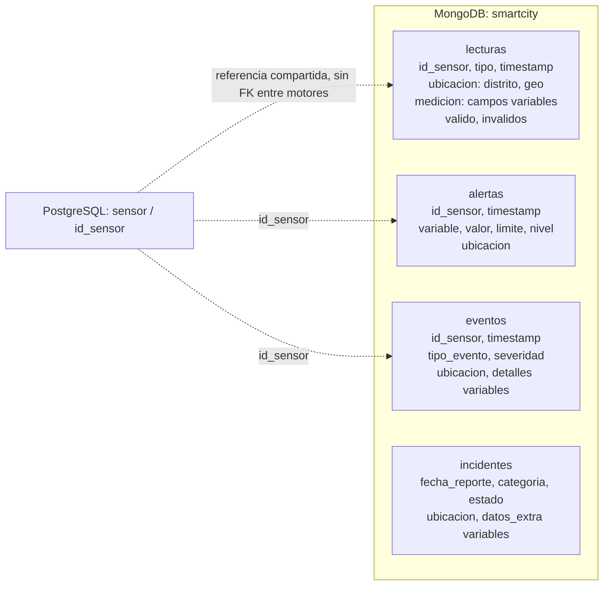

# Implementacion MongoDB - Persona D

## Problema y alcance del avance

SmartCity Analytics integra informacion urbana de Madrid de distintos sensores.
Una lectura de trafico contiene intensidad, ocupacion y carga; una ambiental puede
incluir NO2, PM10, PM2.5, CO y O3. Los eventos e incidentes agregan detalles que no
son uniformes. La parte documental conserva esas diferencias y permite responder
preguntas mediante filtros, actualizaciones y Aggregation Framework.

Este aporte cubre el CRUD y las consultas de Persona D del Sprint 1. Se apoya en
la infraestructura, contrato, ingesta e indices de Cesar. El diagrama documental
y la integracion del documento tecnico corresponden a Persona B. Hadoop, Spark,
dashboard y despliegue distribuido no forman parte de esta implementacion.

## Fuentes y procedencia

Se utiliza la carga existente, descrita en [generacion de datos](../../docs/generacion_datos.md):
calidad del aire y trafico de datos.madrid.es, clima de Open-Meteo y patron de energia
de UCI. Los componentes no disponibles como datos abiertos se generan con semilla 42.
Los incidentes son sinteticos; las alertas y eventos se derivan de reglas del cargador.
Esta implementacion no realiza nuevas descargas ni modifica las fuentes o sus licencias.
Los requisitos de atribucion y licencia se mantienen bajo la documentacion de ingesta
del equipo; no se afirma que hayan sido auditados en este trabajo.

El enunciado exige al menos 500.000 documentos MongoDB. La instancia examinada
contiene 3.151.581 lecturas, 49.448 alertas, 8.936 eventos y 4.000 incidentes:
**3.213.965 documentos** entre las cuatro colecciones. El subconjunto de julio de
2026 incluye 661.491 lecturas. Estos valores se respaldan con conteos ejecutados,
no con una estimacion a partir del tamano de los archivos.

## Arquitectura y modelo documental

MongoDB 7 se ejecuta en un servicio Docker y almacena documentos BSON en `smartcity`.
Los catalogos relacionales y las mediciones limpias agregadas permanecen en PostgreSQL.
`id_sensor` es la referencia compartida; MongoDB no impone una llave foranea entre motores.

| Coleccion | Campos principales | Variabilidad y uso |
|---|---|---|
| lecturas | id_sensor, tipo, categoria, ubicacion, timestamp, medicion, valido, invalidos | medicion contiene distintas variables; ubicacion incluye distrito, nombre y punto GeoJSON |
| eventos | id_sensor, tipo_evento, severidad, ubicacion, timestamp, detalles | detalles depende del evento, por ejemplo congestion o contaminacion |
| alertas | id_sensor, variable, valor, limite, nivel, ubicacion, timestamp, atendida | compara una medicion con el criterio definido por el proyecto |
| incidentes | categoria, descripcion, ubicacion, fecha_reporte, estado, organismo, datos_extra | datos_extra distingue heridos, agua, clientes afectados y otras propiedades |

Se conserva el modelo existente. La ubicacion se incorpora al documento para
consultar por zona sin unir continuamente con PostgreSQL. Esto favorece lecturas
autocontenidas, a cambio de duplicacion y de coordinar cambios de catalogos en la ingesta.
Los documentos de lectura, alerta y evento no son intercambiables: el cargador puede
deduplicar eventos por sensor/dia mientras conserva multiples alertas.

La flexibilidad se demuestra con documentos anidados y con `$objectToArray` y
`$unwind`: las claves variables de medicion se convierten en pares variable/valor
que pueden filtrarse y agruparse. Los campos dinamicos de incidentes se consultan
directamente mediante rutas como `datos_extra.heridos`.

## Diagrama del modelo documental

Las cajas representan colecciones con documentos anidados. No se modela una relacion
obligatoria de incidente a sensor: el contrato de incidentes no contiene id_sensor.
Las flechas muestran referencias logicas, no relaciones impuestas por MongoDB.

## Reglas de analisis y decisiones

Se usan rangos semiabiertos `[desde, hasta)` y julio de 2026 como ejemplo comun.
Las fechas se consultan como BSON Date, no como texto. El contrato declara hora
de Madrid, pero el cargador usa datetime sin zona explicita y PyMongo los almacena
interpretandolos como UTC. Se preserva esa codificacion sin desplazamientos nuevos.
La serie diaria representa el dia almacenado; no se atribuye una correccion de horario
de verano que la ingesta no realizo. Una correccion requeriria revisar y recargar datos.

Las consultas de detalle muestran los datos crudos y sus marcas de calidad.
En estadisticas se exige un valor numerico y una variable no marcada en `invalidos`.
Si `valido:false` no incluye una lista no vacia de variables invalidas, se excluye el
documento de las estadisticas. Una lectura parcialmente invalida puede aportar sus
otras variables sanas. Campos ausentes, nulos o de texto no se interpretan como cero.

Cada variable conserva su unidad. El promedio pondera por igual cada valor disponible,
sin igualar la cobertura entre sensores ni imputar dias. Las salidas incluyen cantidad,
minimo y maximo para interpretar el promedio. No se redondean valores antes de agregar.
La consulta 9 cuenta documentos crudos, no la cantidad de variables de cada documento.

Los detalles muestran hasta 100 documentos, con orden explicito y `_id` como desempate.
Las estadisticas procesan todos los documentos del filtro. Los resultados vacios son
validos y no se sustituyen por datos de demostracion en la base del proyecto.

## Operaciones y consultas

El archivo independiente crud.js, pegado en la shell integrada de Compass, realiza y verifica insertOne, insertMany, find, findOne, updateOne, updateMany
y deleteOne. Utiliza una base temporal de nombre unico por ejecucion.
La limpieza en finally elimina los documentos de la demostracion y la base temporal;
los historicos del proyecto permanecen intactos. No requiere transacciones ni replica set.

Las diez consultas obligatorias responden, respectivamente: lecturas de un sensor,
lecturas por fechas, extremos, eventos criticos, alertas por zona, promedios por zona,
promedios por tipo, incidentes por categoria, conteo agregado por sensor y filtros
multiples. Las consultas 6-10 utilizan Aggregation Framework.

Las complementarias cubren temperatura por zona, sensores sobre limites,
ranking de contaminacion, evolucion temporal e incidentes con heridos. El ranking
compara un contaminante a la vez: sumar NO2, CO y PM2.5 careceria de una unidad comun.
Los limites son parametros del proyecto, no una afirmacion de normativa sanitaria.

La [matriz de cobertura](README.md#cobertura-del-cronograma-y-del-enunciado) relaciona
cada operacion, filtro, proyeccion, ordenamiento, agrupacion e indice con su archivo.
Las quince consultas son pipelines autonomos comentados para Aggregations de Compass
y constituyen la unica fuente editable de las consultas.
El guardado en Compass es local y no se sincroniza con Git ni con el servidor.

## Verificacion y rendimiento

El estado comprobado y los pendientes estan en [VERIFICACION.md](VERIFICACION.md).
La revision ejecuta los quince pipelines sobre la carga disponible, comprueba conteos
seleccionados y ejemplos, repite el CRUD y contrasta los hashes documentales antes y
despues. Esta comprobacion no equivale a auditar todos los valores ni a reconstruir
el proyecto completo en otra computadora.

Los indices estan definidos en `mongo/rendimiento/indices.js`. Se crean desde la shell
integrada de Compass despues de cargar los datos. Un filtro selectivo puede usar un
indice; una agregacion amplia puede recorrer la coleccion. Explain muestra la eleccion
real del optimizador. Los resultados comparativos de indices estan resumidos en
[rendimiento Mongo](../../docs/rendimiento_mongo.md); son un experimento separado.
El benchmark elimina y recrea indices para medirlos, por lo que no forma parte del uso
normal de consultas ni del procedimiento de instalacion de indices.

## Justificacion tecnologica y conclusiones

MongoDB aporta un modelo adecuado para lecturas y detalles heterogeneos y permite
consultarlos y agregarlos sin convertir previamente cada atributo en una columna
uniforme. PostgreSQL mantiene el rol relacional y los resultados limpios. La eleccion
se justifica por estructura, calidad y consultas, no solo por aceptar JSON.

El volumen supera el minimo requerido y permite observar diferencias de acceso con
indices. Sin embargo, el servicio actual es unico: no demuestra sharding, replicacion
ni tolerancia a fallos. Hadoop y Spark abordaran las necesidades distribuidas del
proyecto en los siguientes avances. No se atribuyen esas capacidades a las pruebas actuales.

La entrega de Persona D queda en `MDB/consultas`. No se abre PR ni se integra a main.
Quedan para el grupo la revision por otro integrante, la integracion de este texto y
del diagrama en el documento de B, el ensayo conjunto y la entrega del avance.
